<p align="center">
  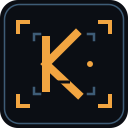
</p>

<h1 align="center">KANGUR</h1>

<p align="center">
  <b>Near-future Europe, two corporate armies, one contract at a time.</b><br/>
  <sub>A singleplayer topdown tactical shooter where the enemy plays like people.</sub>
</p>

<p align="center">
  <a href="docs/media/promo.mp4">
	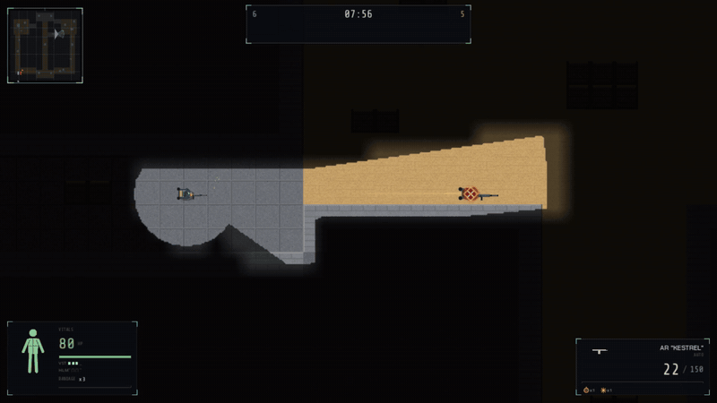
  </a>
  <br/>
  <sub><a href="docs/media/promo.mp4">Watch the full promo, 90 seconds with the game's own soundtrack</a>. Captured in-engine from real matches.</sub>
</p>

> It borrows CS2D's look and camera and Hotline Miami's lethality. Firearms
> reward stopping, bracing, and bursting, wounds matter, and NPCs perceive
> exactly what you perceive and play like people.

## About This Game

The ports went private years ago. Bastion Security Group and Sirocco Extraction
Corps now fight proxy wars over terminals, docks, and old-town power seats on
deniable contracts, paid in full.

You are a contractor. Pick a faction, a class, and a loadout, choose how many
operators you want against you (up to 12v12) and how sharp they are, then deploy.

Bullets are real projectiles that penetrate and lose damage over range, with
spread that blooms under sustained fire. Bodies are split into parts that bleed
and cripple. The people shooting at you camp,
flank, check their six, panic out of kill zones, and linger at corners, because
they see, hear, and remember through the same sensors you do. Every match is
seeded fresh.

Features

- Fair, human-feeling NPCs: cone vision, occluded hearing, delayed noisy radio. Headless sims assert zero wallhacks.
- Firearm handling that rewards stopping, bracing, and bursting.
- Body-part wounds: legs slow you, arms ruin your aim, bleeding kills you.
- Frag, flash, and smoke that interact with the vision simulation itself.
- 3 modes · 5 maps · 12 weapons · 5 classes · 4 bot skill presets.
- Full contract flow: title → operations desk → match → debrief. Holo HUD, occluded spatial audio, adaptive soundtrack.

<sub>Contains stylized firearm violence and blood.</sub>

## They see what you see

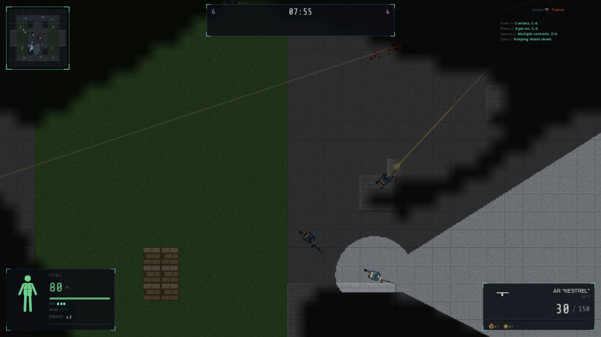

Your operator has a vision cone, and the world outside it is dark. Walls block
sight. Sprinting narrows your cone; crouching behind low cover drops you out of
the enemy's picture. Gunshots carry across the map, but concrete muffles them
and distance eats them. Your team's radio is delayed and noisy: contacts arrive
late, jittered, and fade from the minimap. You know what your operator knows.

## They play like people

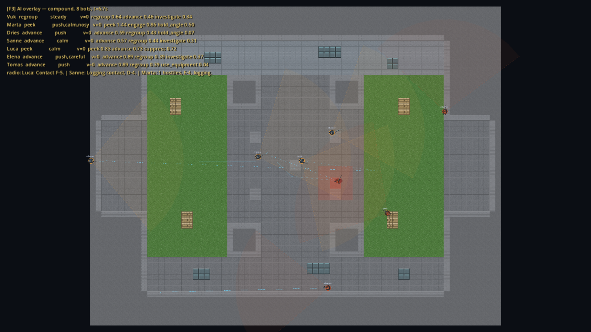
<sub>Live AI telemetry (F3): perception cones, nav paths, current actions, danger heat, radio log.</sub>

Seventeen behaviors drive every NPC: advance, engage, suppress, take cover,
peek, flank, hold angle, check six, investigate, retreat, regroup, bandage,
reload, avoid danger, use equipment, capture and defend objectives.
Personalities are rolled per match. Squads rotate point, flank, support, and
anchor roles. Danger maps remember where people died, and kill zones make bots
route around them or panic through them.

An NPC may only shoot at what it has seen or recently heard, using the same
sensors you have. Headless battle simulations assert zero wallhacks, no
bunching, and clean termination on every gate.

## Stop. Brace. Burst.

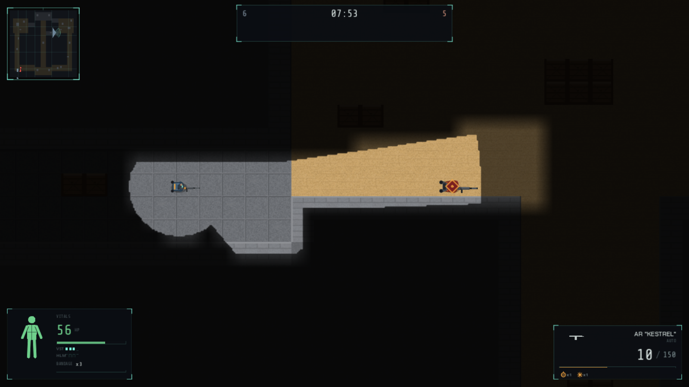

Twelve weapons, from the P-9 "Adder" to the SR "Lynx", all firing real
projectiles swept per tick. Bullets penetrate wood and glass; sniper rounds
bite through thin concrete. Damage falls off with range. Spread blooms with
movement and sustained fire, and recovers when you stop, crouch, or brace.
Recoil kicks the rig and the camera. Reloads are commitments.

## Wounds that matter

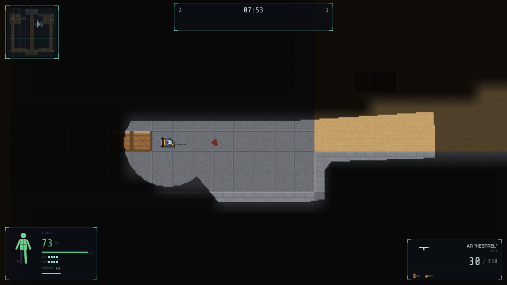

Heads take triple damage. Arms, legs, and torso each have their own health: a
crippled leg cuts your speed nearly in half and kills your sprint; a ruined arm
widens every burst and slows every reload. Limb wounds bleed; torso wounds bleed
faster. The vitals panel shows every part and every droplet while the low-HP
vignette closes in. Fight, or find cover and hold the bandage key for a
2.8-second channel you have to survive.

## Smoke kills vision

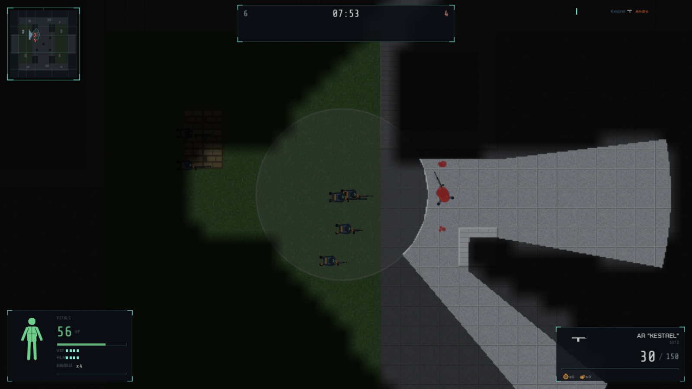

Grenades are physical: lobbed arcs, cookable fuses, bounce. Smoke is part of
the vision simulation: it punches holes in everyone's fog, including yours, so
a push through smoke is a push blind. Flashbangs blind through line of sight
only. Frags clear cover camps.

## Three ways to fight

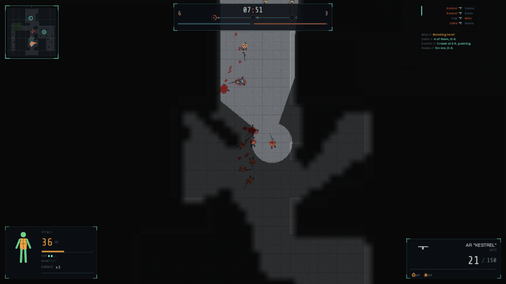

- Elimination: one life each. Surviving team wins; timeout counts survivors, then torso HP. *Dustworks, Compound.*
- Battle: attackers chain A→B→C under a ticket clock; defenders hold, recapture, and bleed the assault dry. *Terminal (the port), Oldtown (plaza, church, administration).*
- Training Range: no fog, no clock. Five lanes, static and rail-moving dummies, weapon racks, a bandage dummy. Learn the bloom before you sell your life.

Five classes: Vanguard (line assault), Bulwark (belt-fed support), Ram
(breacher), Pathfinder (recon), Longshot (marksman). Four bot skills, Recruit
to Elite, tune reaction, aim error, and aggression. Perception stays the same
at every difficulty.

## Screenshots

<p align="center">
  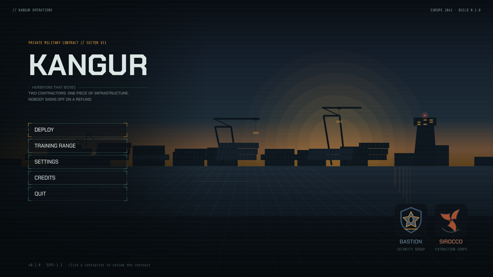
  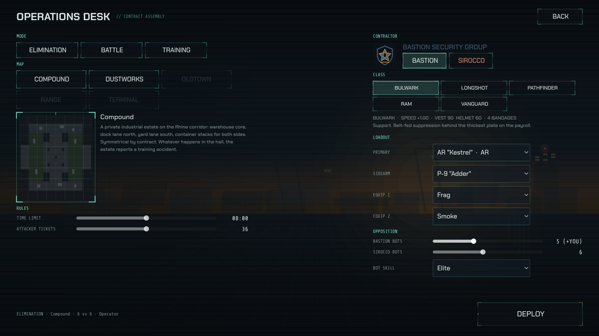
  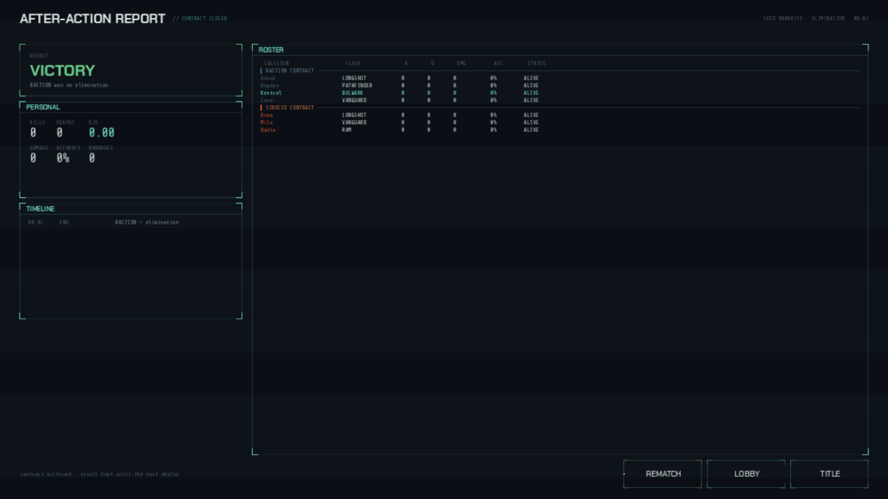
</p>

## Get the build

Prebuilt binaries for **Linux x86_64** and **Windows x86_64** are on the
[releases page](https://github.com/maxwelljens/kangur/releases/latest). Each
archive holds one self-contained executable with the game data embedded — unzip
and run, no installation or dependencies. `SHA256SUMS.txt` on the release lists
the archive checksums.

To build them yourself, run `tools/build_release.sh` with Godot 4.7.2; it
installs and verifies the matching export templates, exports both presets, and
writes the archives plus checksums into `build/`.

## Play the vertical slice

Kangur is a playable end-to-end vertical slice: the full title → lobby → match
→ debrief flow works, Elimination and Battle run with up to 12v12 fair NPCs,
and the Training Range is open. 583 unit tests green; the verify gate runs
headless battle sims that assert the fairness invariants. Balance tuning
(Battle captures, Elimination decisiveness) is underway. The gap list lives in
`docs/production-todo.md`.

Requirements: [Godot 4.7.2](https://godotengine.org) (standard build, not
.NET), GL Compatibility renderer. No other dependencies.

```bash
godot --path . -e        # editor
godot --path .           # play
tools/verify.sh          # full gate: unit tests + battle sims + screenshots
```

Contributors: run Godot through `tools/godot.sh` (flock-serialized; concurrent
runs corrupt the import cache).

## For developers & modders

Start with [AGENTS.md](AGENTS.md), the development manual. Technical contracts:
`docs/architecture.md`. Design bible: `docs/design/game-design.md`.

Adding weapons, classes, maps, factions, or difficulty presets needs no code:
everything is `.tres` data under `data/`. See `docs/adding-content.md`.
Gameplay math lives in pure RefCounted models behind node shells, which is what
makes the headless tests and seeded battle sims possible.

Regenerate the promo video: `tools/promo/capture.sh` records real matches
in-engine, then `deno run -A docs/media/promo/promo.ts` composites and encodes.
Details: `docs/media/promo/README.md`.

## The metaproject & thoughts

What you see here is a pretty generic project made with LLMs, but I think
there's a few interesting words about how it was achieved. I was testing [Qwen4
Max](https://qwen.ai/blog?id=qwen4-max) (+ DeepSeek V4.1 Flash subagents) to
see how far the Chinese have advanced in affordable frontier LLMs.

All of what you see here was the product of almost one prompt. I only made
minor corrections with some input and NPC issues. Otherwise, the entire game
project was generated with one prompt. The promotional video was another
prompt. Yet all of this cost me one maxed out 7 dollar plan from Alibaba Cloud.
Probably could have cost me even less with something like OpenCode Go, but
nevertheless highly compelling results for very little cost.

## Licence

Code: EUPL-1.2 (`LICENCE`). Third-party assets keep their own licenses
(CC0/CC-BY), attributed in `docs/credits.md` and the in-game Credits screen.
